# L17 페르소나 시장 정합성

state: provisional · gate: gate_pending

- RQ1 대표성: 미달
- RQ2 정보 기여: 있음
- RQ3 판정 안정성: 안정
- H4 세그먼트 방향: 입증 안 됨

95% 구간은 세 반복의 평균 비율과 가장 작은 해당 분모를 쓴 Wilson 근사입니다. 같은 300명을 반복하므로 900명으로 계산하지 않습니다. 반복 범위는 별도입니다. 기관 통계 자체의 조사오차는 포함하지 않습니다.

## 조합 1

- 제외 0/900 (0.00%). 반복별 제외: [0, 0, 0].
- 응답 쏠림 · V1 음주 빈도 「월 2~4회」 900/900 (100.0%).
- 응답 쏠림 · V2 폭음 빈도 「월 1회 미만」 899/900 (99.9%).
- 응답 쏠림 · V3 최근 6개월 음주 여부 「예」 900/900 (100.0%).
- 응답 쏠림 · V3 주로 마신 술 「소주」 900/900 (100.0%).
- 응답 쏠림 · V3 주로 마신 술 「맥주」 900/900 (100.0%).

### V1

평균 절대 차이 40.30%p (반복 범위 40.30 ~ 40.30). 스피어만 계산 불가.

| 항목 | 응답 % | 기관 % | 차이 %p | 반복 범위 % | 응답 95% 구간 % | 분모(회별) |
|---|---:|---:|---:|---|---|---|
| 전체 | 100.00 | 59.70 | 40.30 | 100.00 ~ 100.00 | 98.74 ~ 100.00 | [300, 300, 300] |

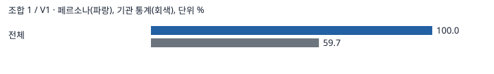

### V2

평균 절대 차이 37.80%p (반복 범위 37.80 ~ 37.80). 스피어만 계산 불가.

| 항목 | 응답 % | 기관 % | 차이 %p | 반복 범위 % | 응답 95% 구간 % | 분모(회별) |
|---|---:|---:|---:|---|---|---|
| 전체 | 0.00 | 37.80 | -37.80 | 0.00 ~ 0.00 | 0.00 ~ 1.26 | [300, 300, 300] |

### V3

평균 절대 차이 20.44%p (반복 범위 20.44 ~ 20.44). 스피어만 0.70.

| 항목 | 응답 % | 기관 % | 차이 %p | 반복 범위 % | 응답 95% 구간 % | 분모(회별) |
|---|---:|---:|---:|---|---|---|
| 맥주 | 100.00 | 94.60 | 5.40 | 100.00 ~ 100.00 | 98.74 ~ 100.00 | [300, 300, 300] |
| 소주 | 100.00 | 77.10 | 22.90 | 100.00 ~ 100.00 | 98.74 ~ 100.00 | [300, 300, 300] |
| 탁주(막걸리) | 0.00 | 52.30 | -52.30 | 0.00 ~ 0.00 | 0.00 ~ 1.26 | [300, 300, 300] |
| 과실주(와인 등) | 0.00 | 31.50 | -31.50 | 0.00 ~ 0.00 | 0.00 ~ 1.26 | [300, 300, 300] |
| 청주 | 0.00 | 21.70 | -21.70 | 0.00 ~ 0.00 | 0.00 ~ 1.26 | [300, 300, 300] |
| 위스키 | 0.00 | 21.40 | -21.40 | 0.00 ~ 0.00 | 0.00 ~ 1.26 | [300, 300, 300] |
| 약주 | 0.00 | 14.30 | -14.30 | 0.00 ~ 0.00 | 0.00 ~ 1.26 | [300, 300, 300] |
| 리큐르 | 0.00 | 13.20 | -13.20 | 0.00 ~ 0.00 | 0.00 ~ 1.26 | [300, 300, 300] |
| 일반증류주(증류식 소주 등) | 0.00 | 11.90 | -11.90 | 0.00 ~ 0.00 | 0.00 ~ 1.26 | [300, 300, 300] |
| 브랜디 | 0.00 | 9.80 | -9.80 | 0.00 ~ 0.00 | 0.00 ~ 1.26 | [300, 300, 300] |

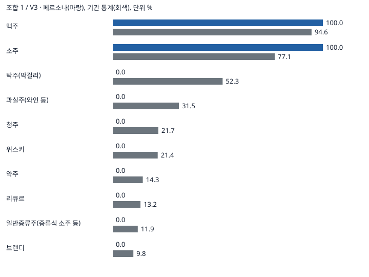

- 보조 음주량(회별 평균): 소주 3.44, 3.44, 3.47잔(기관 5.4), 맥주 2.00, 2.01, 2.01잔(기관 4.4).

## 조합 2

- 제외 0/900 (0.00%). 반복별 제외: [0, 0, 0].
- 응답 쏠림 · V3 주로 마신 술 「소주」 753/781 (96.4%).

### V1

평균 절대 차이 17.09%p (반복 범위 16.45 ~ 17.88). 스피어만 1.00.

| 항목 | 응답 % | 기관 % | 차이 %p | 반복 범위 % | 응답 95% 구간 % | 분모(회별) |
|---|---:|---:|---:|---|---|---|
| 남자 | 96.88 | 68.20 | 28.67 | 95.62 ~ 97.50 | 92.89 ~ 98.66 | [160, 160, 160] |
| 여자 | 56.90 | 51.40 | 5.50 | 55.00 ~ 57.86 | 48.63 ~ 64.82 | [140, 140, 140] |

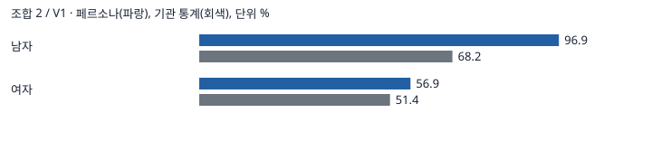

### V2

평균 절대 차이 29.55%p (반복 범위 28.55 ~ 30.53). 스피어만 0.88.

| 항목 | 응답 % | 기관 % | 차이 %p | 반복 범위 % | 응답 95% 구간 % | 분모(회별) |
|---|---:|---:|---:|---|---|---|
| 남자 19~39 | 15.00 | 47.80 | -32.80 | 12.50 ~ 20.00 | 7.06 ~ 29.07 | [40, 40, 40] |
| 남자 40~59 | 9.66 | 54.60 | -44.94 | 7.25 ~ 11.59 | 4.68 ~ 18.90 | [69, 69, 69] |
| 남자 60+ | 0.00 | 34.40 | -34.40 | 0.00 ~ 0.00 | 0.00 ~ 7.00 | [51, 51, 51] |
| 여자 19~39 | 0.93 | 37.40 | -36.47 | 0.00 ~ 2.78 | 0.07 ~ 11.25 | [36, 36, 36] |
| 여자 40~59 | 0.00 | 21.70 | -21.70 | 0.00 ~ 0.00 | 0.00 ~ 7.13 | [50, 50, 50] |
| 여자 60+ | 0.00 | 7.00 | -7.00 | 0.00 ~ 0.00 | 0.00 ~ 6.64 | [54, 54, 54] |

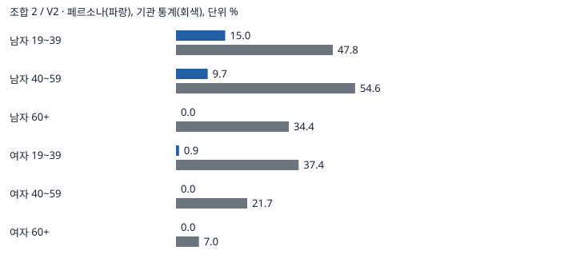

### V3

평균 절대 차이 18.40%p (반복 범위 18.38 ~ 18.42). 스피어만 0.87.

| 항목 | 응답 % | 기관 % | 차이 %p | 반복 범위 % | 응답 95% 구간 % | 분모(회별) |
|---|---:|---:|---:|---|---|---|
| 맥주 | 92.57 | 94.60 | -2.03 | 91.80 ~ 93.18 | 88.69 ~ 95.19 | [261, 256, 264] |
| 소주 | 96.42 | 77.10 | 19.32 | 96.17 ~ 96.88 | 93.37 ~ 98.09 | [261, 256, 264] |
| 탁주(막걸리) | 11.53 | 52.30 | -40.77 | 10.73 ~ 12.50 | 8.17 ~ 16.02 | [261, 256, 264] |
| 과실주(와인 등) | 1.92 | 31.50 | -29.58 | 1.52 ~ 2.30 | 0.82 ~ 4.45 | [261, 256, 264] |
| 청주 | 0.00 | 21.70 | -21.70 | 0.00 ~ 0.00 | 0.00 ~ 1.48 | [261, 256, 264] |
| 위스키 | 0.00 | 21.40 | -21.40 | 0.00 ~ 0.00 | 0.00 ~ 1.48 | [261, 256, 264] |
| 약주 | 0.00 | 14.30 | -14.30 | 0.00 ~ 0.00 | 0.00 ~ 1.48 | [261, 256, 264] |
| 리큐르 | 0.00 | 13.20 | -13.20 | 0.00 ~ 0.00 | 0.00 ~ 1.48 | [261, 256, 264] |
| 일반증류주(증류식 소주 등) | 0.00 | 11.90 | -11.90 | 0.00 ~ 0.00 | 0.00 ~ 1.48 | [261, 256, 264] |
| 브랜디 | 0.00 | 9.80 | -9.80 | 0.00 ~ 0.00 | 0.00 ~ 1.48 | [261, 256, 264] |

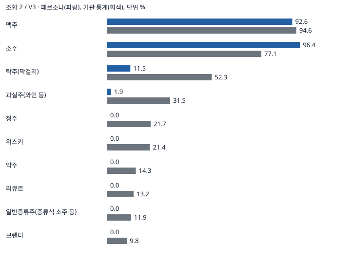

- 보조 음주량(회별 평균): 소주 3.58, 3.57, 3.52잔(기관 5.4), 맥주 1.92, 1.95, 1.85잔(기관 4.4).

## 조합 3

- 제외 0/900 (0.00%). 반복별 제외: [0, 0, 0].
- 응답 쏠림 95% 이상 없음.
- 자료별 판정: V1 미달, V2 미달, V3 미달

### V1

평균 절대 차이 16.99%p (반복 범위 15.89 ~ 17.81). 스피어만 1.00.

| 항목 | 응답 % | 기관 % | 차이 %p | 반복 범위 % | 응답 95% 구간 % | 분모(회별) |
|---|---:|---:|---:|---|---|---|
| 남자 | 86.25 | 68.20 | 18.05 | 85.00 ~ 88.12 | 80.06 ~ 90.74 | [160, 160, 160] |
| 여자 | 35.48 | 51.40 | -15.92 | 34.29 ~ 36.43 | 28.04 ~ 43.69 | [140, 140, 140] |

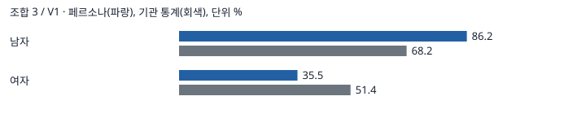

### V2

평균 절대 차이 31.09%p (반복 범위 30.77 ~ 31.42). 스피어만 0.52.

| 항목 | 응답 % | 기관 % | 차이 %p | 반복 범위 % | 응답 95% 구간 % | 분모(회별) |
|---|---:|---:|---:|---|---|---|
| 남자 19~39 | 7.50 | 47.80 | -40.30 | 7.50 ~ 7.50 | 2.58 ~ 19.86 | [40, 40, 40] |
| 남자 40~59 | 2.90 | 54.60 | -51.70 | 2.90 ~ 2.90 | 0.80 ~ 9.97 | [69, 69, 69] |
| 남자 60+ | 3.27 | 34.40 | -31.13 | 1.96 ~ 5.88 | 0.81 ~ 12.27 | [51, 51, 51] |
| 여자 19~39 | 0.00 | 37.40 | -37.40 | 0.00 ~ 0.00 | 0.00 ~ 9.64 | [36, 36, 36] |
| 여자 40~59 | 2.67 | 21.70 | -19.03 | 2.00 ~ 4.00 | 0.57 ~ 11.51 | [50, 50, 50] |
| 여자 60+ | 0.00 | 7.00 | -7.00 | 0.00 ~ 0.00 | 0.00 ~ 6.64 | [54, 54, 54] |

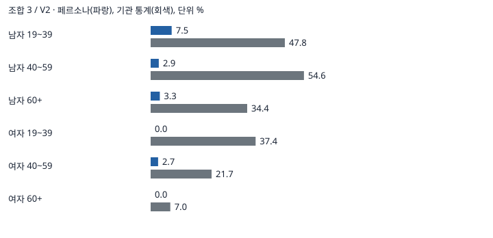

### V3

평균 절대 차이 19.10%p (반복 범위 19.00 ~ 19.15). 스피어만 0.96.

| 항목 | 응답 % | 기관 % | 차이 %p | 반복 범위 % | 응답 95% 구간 % | 분모(회별) |
|---|---:|---:|---:|---|---|---|
| 맥주 | 76.45 | 94.60 | -18.15 | 75.45 ~ 78.26 | 70.48 ~ 81.53 | [230, 234, 224] |
| 소주 | 68.74 | 77.10 | -8.36 | 67.83 ~ 69.66 | 62.40 ~ 74.46 | [230, 234, 224] |
| 탁주(막걸리) | 5.24 | 52.30 | -47.06 | 4.70 ~ 5.80 | 3.00 ~ 8.99 | [230, 234, 224] |
| 과실주(와인 등) | 4.21 | 31.50 | -27.29 | 4.02 ~ 4.35 | 2.26 ~ 7.71 | [230, 234, 224] |
| 청주 | 0.87 | 21.70 | -20.83 | 0.85 ~ 0.89 | 0.24 ~ 3.16 | [230, 234, 224] |
| 위스키 | 1.31 | 21.40 | -20.09 | 1.28 ~ 1.34 | 0.44 ~ 3.82 | [230, 234, 224] |
| 약주 | 0.00 | 14.30 | -14.30 | 0.00 ~ 0.00 | 0.00 ~ 1.69 | [230, 234, 224] |
| 리큐르 | 0.00 | 13.20 | -13.20 | 0.00 ~ 0.00 | 0.00 ~ 1.69 | [230, 234, 224] |
| 일반증류주(증류식 소주 등) | 0.00 | 11.90 | -11.90 | 0.00 ~ 0.00 | 0.00 ~ 1.69 | [230, 234, 224] |
| 브랜디 | 0.00 | 9.80 | -9.80 | 0.00 ~ 0.00 | 0.00 ~ 1.69 | [230, 234, 224] |

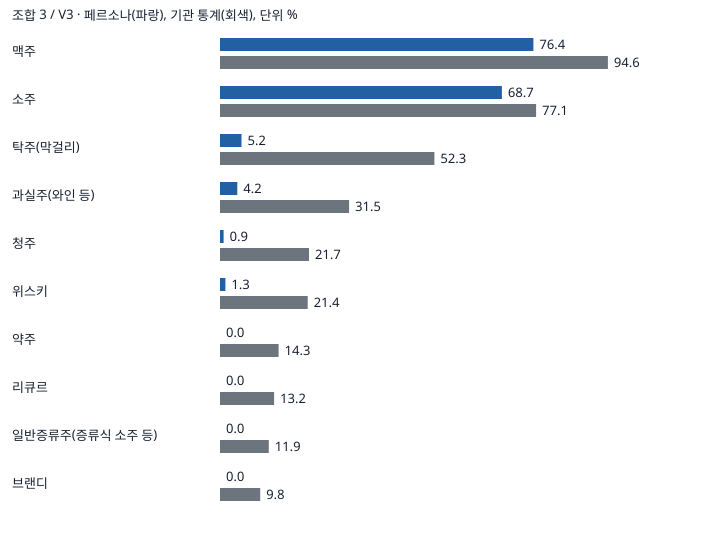

- 보조 음주량(회별 평균): 소주 3.10, 3.07, 3.05잔(기관 5.4), 맥주 1.68, 1.63, 1.66잔(기관 4.4).

## 조합 4

- 제외 3/900 (0.33%). 반복별 제외: [1, 1, 1].
- 응답 쏠림 · V3 주로 마신 술 「맥주」 823/837 (98.3%).
- 응답 쏠림 · V3 주로 마신 술 「소주」 800/837 (95.6%).
- 자료별 판정: V1 미달, V2 통과, V3 미달

### V1

평균 절대 차이 24.93%p (반복 범위 24.44 ~ 25.47). 스피어만 1.00.

| 항목 | 응답 % | 기관 % | 차이 %p | 반복 범위 % | 응답 95% 구간 % | 분모(회별) |
|---|---:|---:|---:|---|---|---|
| 남자 | 94.17 | 68.20 | 25.97 | 93.12 ~ 95.00 | 89.40 ~ 96.87 | [160, 160, 160] |
| 여자 | 75.30 | 51.40 | 23.90 | 74.10 ~ 76.26 | 67.51 ~ 81.72 | [139, 139, 139] |

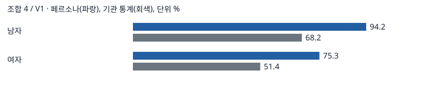

### V2

평균 절대 차이 8.77%p (반복 범위 9.26 ~ 10.59). 스피어만 0.94.

| 항목 | 응답 % | 기관 % | 차이 %p | 반복 범위 % | 응답 95% 구간 % | 분모(회별) |
|---|---:|---:|---:|---|---|---|
| 남자 19~39 | 58.33 | 47.80 | 10.53 | 52.50 ~ 65.00 | 42.99 ~ 72.21 | [40, 40, 40] |
| 남자 40~59 | 55.07 | 54.60 | 0.47 | 46.38 ~ 62.32 | 43.38 ~ 66.23 | [69, 69, 69] |
| 남자 60+ | 39.22 | 34.40 | 4.82 | 31.37 ~ 45.10 | 27.03 ~ 52.91 | [51, 51, 51] |
| 여자 19~39 | 51.35 | 37.40 | 13.95 | 45.71 ~ 55.56 | 35.50 ~ 66.93 | [36, 36, 35] |
| 여자 40~59 | 34.67 | 21.70 | 12.97 | 28.00 ~ 42.00 | 23.00 ~ 48.52 | [50, 50, 50] |
| 여자 60+ | 16.86 | 7.00 | 9.86 | 15.09 ~ 18.52 | 9.12 ~ 29.09 | [53, 53, 54] |

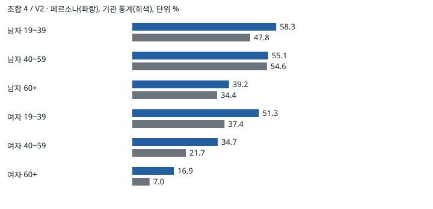

### V3

평균 절대 차이 19.10%p (반복 범위 19.02 ~ 19.23). 스피어만 0.98.

| 항목 | 응답 % | 기관 % | 차이 %p | 반복 범위 % | 응답 95% 구간 % | 분모(회별) |
|---|---:|---:|---:|---|---|---|
| 맥주 | 98.33 | 94.60 | 3.73 | 97.87 ~ 98.57 | 96.02 ~ 99.31 | [275, 282, 280] |
| 소주 | 95.58 | 77.10 | 18.48 | 95.27 ~ 96.10 | 92.45 ~ 97.44 | [275, 282, 280] |
| 탁주(막걸리) | 2.16 | 52.30 | -50.14 | 1.77 ~ 2.91 | 0.99 ~ 4.64 | [275, 282, 280] |
| 과실주(와인 등) | 3.35 | 31.50 | -28.15 | 2.84 ~ 3.64 | 1.78 ~ 6.20 | [275, 282, 280] |
| 청주 | 0.83 | 21.70 | -20.87 | 0.36 ~ 1.43 | 0.25 ~ 2.78 | [275, 282, 280] |
| 위스키 | 0.48 | 21.40 | -20.92 | 0.35 ~ 0.73 | 0.10 ~ 2.22 | [275, 282, 280] |
| 약주 | 0.48 | 14.30 | -13.82 | 0.35 ~ 0.71 | 0.10 ~ 2.22 | [275, 282, 280] |
| 리큐르 | 0.00 | 13.20 | -13.20 | 0.00 ~ 0.00 | 0.00 ~ 1.38 | [275, 282, 280] |
| 일반증류주(증류식 소주 등) | 0.00 | 11.90 | -11.90 | 0.00 ~ 0.00 | 0.00 ~ 1.38 | [275, 282, 280] |
| 브랜디 | 0.00 | 9.80 | -9.80 | 0.00 ~ 0.00 | 0.00 ~ 1.38 | [275, 282, 280] |

- 보조 음주량(회별 평균): 소주 2.34, 2.32, 2.30잔(기관 5.4), 맥주 2.18, 2.22, 2.19잔(기관 4.4).

## 조합 5

- 제외 0/900 (0.00%). 반복별 제외: [0, 0, 0].
- 응답 쏠림 95% 이상 없음.
- 자료별 판정: V1 미달, V2 미달, V3 미달

### V1

평균 절대 차이 15.97%p (반복 범위 14.95 ~ 17.67). 스피어만 1.00.

| 항목 | 응답 % | 기관 % | 차이 %p | 반복 범위 % | 응답 95% 구간 % | 분모(회별) |
|---|---:|---:|---:|---|---|---|
| 남자 | 88.75 | 68.20 | 20.55 | 88.12 ~ 90.00 | 82.92 ~ 92.76 | [160, 160, 160] |
| 여자 | 40.00 | 51.40 | -11.40 | 37.86 ~ 41.43 | 32.26 ~ 48.28 | [140, 140, 140] |

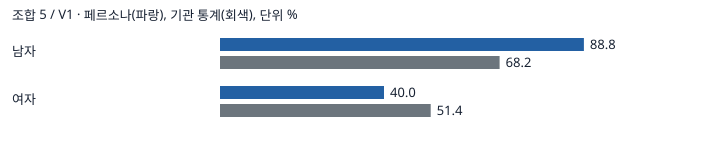

### V2

평균 절대 차이 32.20%p (반복 범위 32.09 ~ 32.41). 스피어만 0.58.

| 항목 | 응답 % | 기관 % | 차이 %p | 반복 범위 % | 응답 95% 구간 % | 분모(회별) |
|---|---:|---:|---:|---|---|---|
| 남자 19~39 | 5.00 | 47.80 | -42.80 | 5.00 ~ 5.00 | 1.38 ~ 16.50 | [40, 40, 40] |
| 남자 40~59 | 1.45 | 54.60 | -53.15 | 1.45 ~ 1.45 | 0.26 ~ 7.76 | [69, 69, 69] |
| 남자 60+ | 3.27 | 34.40 | -31.13 | 1.96 ~ 3.92 | 0.81 ~ 12.27 | [51, 51, 51] |
| 여자 19~39 | 0.00 | 37.40 | -37.40 | 0.00 ~ 0.00 | 0.00 ~ 9.64 | [36, 36, 36] |
| 여자 40~59 | 0.00 | 21.70 | -21.70 | 0.00 ~ 0.00 | 0.00 ~ 7.13 | [50, 50, 50] |
| 여자 60+ | 0.00 | 7.00 | -7.00 | 0.00 ~ 0.00 | 0.00 ~ 6.64 | [54, 54, 54] |

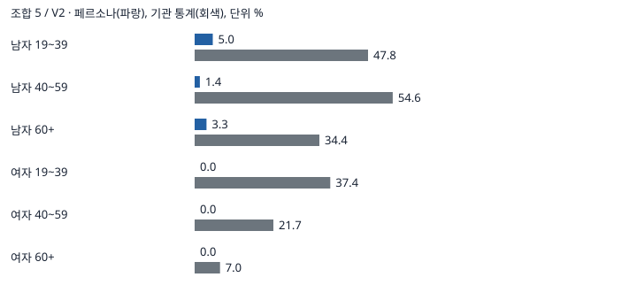

### V3

평균 절대 차이 18.91%p (반복 범위 18.54 ~ 19.22). 스피어만 0.96.

| 항목 | 응답 % | 기관 % | 차이 %p | 반복 범위 % | 응답 95% 구간 % | 분모(회별) |
|---|---:|---:|---:|---|---|---|
| 맥주 | 73.52 | 94.60 | -21.08 | 70.56 ~ 75.51 | 67.67 ~ 78.65 | [247, 248, 245] |
| 소주 | 67.03 | 77.10 | -10.07 | 66.13 ~ 68.57 | 60.92 ~ 72.62 | [247, 248, 245] |
| 탁주(막걸리) | 10.13 | 52.30 | -42.17 | 9.39 ~ 10.89 | 6.95 ~ 14.55 | [247, 248, 245] |
| 과실주(와인 등) | 5.95 | 31.50 | -25.55 | 4.86 ~ 6.94 | 3.61 ~ 9.65 | [247, 248, 245] |
| 청주 | 0.81 | 21.70 | -20.89 | 0.81 ~ 0.82 | 0.22 ~ 2.92 | [247, 248, 245] |
| 위스키 | 1.22 | 21.40 | -20.18 | 1.21 ~ 1.22 | 0.41 ~ 3.53 | [247, 248, 245] |
| 약주 | 0.00 | 14.30 | -14.30 | 0.00 ~ 0.00 | 0.00 ~ 1.54 | [247, 248, 245] |
| 리큐르 | 0.00 | 13.20 | -13.20 | 0.00 ~ 0.00 | 0.00 ~ 1.54 | [247, 248, 245] |
| 일반증류주(증류식 소주 등) | 0.00 | 11.90 | -11.90 | 0.00 ~ 0.00 | 0.00 ~ 1.54 | [247, 248, 245] |
| 브랜디 | 0.00 | 9.80 | -9.80 | 0.00 ~ 0.00 | 0.00 ~ 1.54 | [247, 248, 245] |

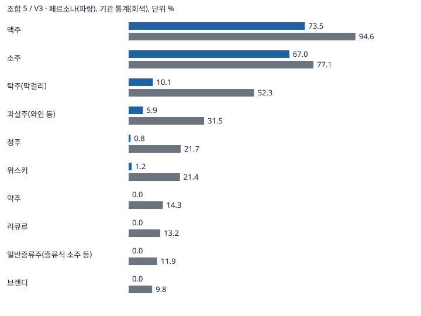

- 보조 음주량(회별 평균): 소주 3.07, 3.05, 3.05잔(기관 5.4), 맥주 1.64, 1.64, 1.62잔(기관 4.4).

## RQ2 자료별 비교

| 자료 | 전체 서술 개선 %p | 반복 흔들림 %p | 단계별 오차 감소 | 판정 |
|---|---:|---:|---|---|
| V1 | 23.31 | 1.92 | 예 | 기여 있음 |
| V2 | 6.71 | 0.65 | 아니오 | 기여 있음 |
| V3 | 1.34 | 0.16 | 아니오 | 기여 있음 |

## H4 연령군별 비교

조합 3의 최근 6개월 음주자 기준. 차이는 혁신자·초기 수용자 비율에서 후기 다수·지체자 비율을 뺀 값입니다.

| 연령 | 주종 | 초기 % | 후기 % | 차이 %p | 반복 범위 %p | 차이 95% 구간 %p |
|---|---|---:|---:|---:|---|---|
| 전체 | 위스키 | 0.00 | 0.00 | 0.00 | 0.00 ~ 0.00 | -3.77 ~ 10.15 |
| 전체 | 리큐르 | 0.00 | 0.00 | 0.00 | 0.00 ~ 0.00 | -3.77 ~ 10.15 |
| 전체 | 과실주(와인 등) | 11.13 | 0.00 | 11.13 | 8.11 ~ 13.51 | 3.33 ~ 25.84 |
| 19~39 | 위스키 | 0.00 | 0.00 | 0.00 | 0.00 ~ 0.00 | -22.81 ~ 20.39 |
| 19~39 | 리큐르 | 0.00 | 0.00 | 0.00 | 0.00 ~ 0.00 | -22.81 ~ 20.39 |
| 19~39 | 과실주(와인 등) | 3.92 | 0.00 | 3.92 | 0.00 ~ 11.76 | -19.15 ~ 26.16 |
| 40~59 | 위스키 | 0.00 | 0.00 | 0.00 | 0.00 ~ 0.00 | -8.03 ~ 16.82 |
| 40~59 | 리큐르 | 0.00 | 0.00 | 0.00 | 0.00 ~ 0.00 | -8.03 ~ 16.82 |
| 40~59 | 과실주(와인 등) | 17.54 | 0.00 | 17.54 | 15.79 ~ 21.05 | 3.87 ~ 39.53 |
| 60+ | 위스키 | — | — | — | — | — |
| 60+ | 리큐르 | — | — | — | — | — |
| 60+ | 과실주(와인 등) | — | — | — | — | — |

해석 범위: V3 기관 통계는 2020년 15세 이상을 포함하지만, 합성 표본은 19세 이상입니다. 기관 정답을 재현하더라도 사람과 나란히 조사한 결과나 신제품 예측력으로 해석할 수 없습니다.

## 호출 경로

- 전체 요청 수(재요청 및 전환 전 제외분 포함) {'api': 4526}
- 판정 대상 응답 자리 수(형식 제외 전) {'api': 4500}
